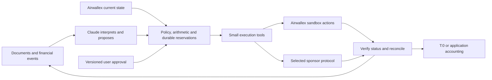

# Agentic Banking Hackathon: research, 36 ideas and a build shortlist

Research date: **24 October 2026**. Prepared from the official HackerEarth tabs, the linked builder guide, current primary technology documentation and independent research/review by three parallel agents. This is a researched product proposal portfolio, not a claim that any authenticated integration has been tested. Financial examples and demo outcomes below are synthetic.

**Recommendation:** choose **CashProof** for the strongest straightforward banking build; **Evidence Dividend** for a distinctive multi-sponsor product if platform access arrives; **CacheDividend** for a native Metal business model; or **SecondLife Cart** for a merchant/Visa direction if merchant access is available. **DecisionBudget** is the ambitious option with the richest engineering demonstration. Build one complete decision loop before adding another sponsor.

## Read the research at the depth you need

| Document | Contents |
|---|---|
| [Verified brief](research/brief-verification.md) | All 12 exact tracks, timeline, eligibility, deliverables, prize conditions, source images and unresolved contradictions |
| [Airwallex technology](research/airwallex-technology.md) | Accounts, balances, FX, transfers, cards, disputes, platforms, simulations, event lifecycles and access gates |
| [Visa, Metal and Coinbase](research/sponsor-technology.md) | Protocol mechanics, native controls, credentials, network compatibility, testnet and finality limits |
| [Claude, AWS, T:0 and Base44](research/supporting-technologies.md) | Reasoning, execution policy, accounting freshness, API write permissions, application tooling and architecture implications |
| [12 financial-operation ideas](research/ideas-financial-operations.md) | Full idea cards for tracks 01, 03, 04 and 07 |
| [12 platform and spend ideas](research/ideas-platform-commerce.md) | Full idea cards for tracks 02, 05, 06 and 08 |
| [12 agent-commerce ideas](research/ideas-agent-commerce.md) | Full idea cards for tracks 09, 10, 11 and 12 |

Each detailed idea card specifies the user, neglected problem, mechanism, reason for using an agent, actual Airwallex action, sponsor role, changing-evidence demo, scoped MVP, evaluation and access dependencies.

## 1. What the brief actually says

There are **12 numbered tracks**, presented as starter-kit cards. The page's text-only view misses most of them because the tabs embed images. This portfolio gives three distinct ideas for every numbered track. [Official tracks 01–06](https://uc.hackerearth.com/he-s3-ap-south-1/media/sprint/agentic-banking-hackathon/editor/editor_image_2733610_9216ea9.png), [official tracks 07–12](https://uc.hackerearth.com/he-s3-ap-south-1/media/sprint/agentic-banking-hackathon/editor/editor_image_2733610_1e5cbf6.png)

- **Application deadline:** 25 October 2026, **19:29 Lagos time** (18:29 UTC).
- **Build window:** 27 October–13 November; final submission at **19:29 Lagos time on 13 November**.
- **Finalists:** 15 November. **Demo Day:** 19 November; remote participation is allowed.
- **Team:** 1–4, age 18+, worldwide, free entry. Participants retain project IP.
- **Submission:** working demo, video under five minutes, repository with setup instructions.

Sources: [Event page and phase timestamps](https://www.hackerearth.com/community/challenges/hackathon/agentic-banking-hackathon/), [dates graphic](https://uc.hackerearth.com/he-s3-ap-south-1/media/sprint/agentic-banking-hackathon/editor/editor_image_2733610_f3e517e.png), [FAQ graphic](https://uc.hackerearth.com/he-s3-ap-south-1/media/sprint/agentic-banking-hackathon/editor/editor_image_2733610_ceea493.png).

| Award | Amount | Public condition |
|---|---:|---|
| Founder's Choice | $30,000 | Open category |
| Judges Choice | $20,000 | Open category |
| Visa Award | $15,000 | Use Visa and Airwallex tooling |
| Metal Award | $15,000 | Use Metal and Airwallex tooling |

Claude, AWS and Base44 credits are listed separately; Coinbase and T:0 also supply product capabilities. Their presence does not create additional named cash-prize tracks. The listed prize/credit components conflict with an older $100K headline, and credit allocation per team is unspecified. No public weighted judging rubric or confirmation of award stacking was located. [Prize graphic](https://uc.hackerearth.com/he-s3-ap-south-1/media/sprint/agentic-banking-hackathon/editor/editor_image_2733610_ace7f6e.png), [partners graphic](https://uc.hackerearth.com/he-s3-ap-south-1/media/sprint/agentic-banking-hackathon/editor/editor_image_2733610_c293391.png)

The strongest interpretation of the build guidance is: show a consequential financial choice, introduce information that changes it, execute the revised action and verify the result. This is our selection lens, not an invented official scoring formula. The overview's “48 hours” conflicts with its own three-week language and dated phases; use the explicit dates. [Linked builder guide](https://airwallexdev.com/guide), [overview](https://uc.hackerearth.com/he-s3-ap-south-1/media/sprint/agentic-banking-hackathon/editor/editor_image_2733610_62fda2e.png)

## 2. What the technologies contribute

| Technology | Useful primitive | Product implication | Boundary that changes the build |
|---|---|---|---|
| **Airwallex** | Wallets, FX, transfers, issuing, payments, disputes, connected accounts | The agent changes a financial state and can verify it | APIs and product enablement vary; production AgentOS is not the autonomous money-out runtime |
| **Claude** | Document interpretation, structured decisions, tool use | Extract dependencies and detect contradictions in contracts, invoices and evidence | Correct JSON does not prove correct facts or permission; validate before execution |
| **AWS AgentCore** | Runtime, Identity, Gateway, Policy, traces; Payments for supported wallets/protocols | Make the execution boundary observable and enforceable | Gateway policy covers routed calls; cumulative financial reservations still need durable application state |
| **Visa TAP** | Authenticate agent requests to merchants | Verify who is shopping and preserve authenticated request evidence | Does not prove buyer consent to every SKU, delivery quality or liability shift |
| **Visa Intelligent Commerce** | Tokenized credentials and purchase instructions | Bind payment execution to an authorized purchase flow | Actual execution credentials/onboarding are distinct from public samples |
| **Metal** | Agent mandates, payee/cost/budget limits, signed orders, x402 payments/clearing | Delegate finite payment authority and preserve exact purchase evidence | Custom scheme/network; testnet token is not bank cash; clearing withdrawals are delayed |
| **Coinbase CDP / x402** | Supported-network wallets and paid HTTP services | Buy a specific missing fact or tool under a budget | A payment buys a response, not guaranteed truth; CDP support does not imply Metal support |
| **T:0** | Accounting records, MCP, journals and reports | Connect obligations and payment outcomes to the books | Record freshness can lag; API-key writes and OAuth reads have different permissions |
| **Base44** | UI, authentication, data permissions, server functions | Build the operator's approval/evidence/reconciliation workspace quickly | Financial validation and durable execution cannot be assumed from generated UI/data models |

Primary sources: [Airwallex developer connectors](https://www.airwallex.com/docs/developer-tools/ai/developer-mcp), [AgentOS](https://www.airwallex.com/docs/developer-tools/ai/agentos), [Claude structured outputs](https://platform.claude.com/docs/en/build-with-claude/structured-outputs), [AgentCore](https://docs.aws.amazon.com/bedrock-agentcore/latest/devguide/what-is-bedrock-agentcore.html), [Visa TAP](https://developer.visa.com/docs/trusted-agent-protocol), [Visa toolkit](https://github.com/visa/ai), [Metal mandates](https://docs.metalntwx.com/agents/mandates), [Coinbase facilitator](https://docs.cdp.coinbase.com/x402/seller/facilitator), [T:0 API](https://docs.t0.ai/api/t0-api/description/introduction/index.md), [Base44 features](https://docs.base44.com/developers/backend/overview/features).

Four combinations are particularly productive:

1. **Accounting context → present liquidity → action:** T:0 explains the obligation, Airwallex shows the available money, Claude resolves an exception, then Airwallex executes and the books reconcile.
2. **Missing evidence → paid verification → released cash:** an agent buys a targeted fact through Coinbase or Metal, evaluates it, then changes a payout, reserve or dispute decision.
3. **Purchase intent → enforceable authority → evidence:** Claude interprets the user's constraints; application approval binds exact terms; Visa or Metal supplies the relevant identity/payment primitive; receipts preserve what happened.
4. **Customer revenue → finite agent budgets → delivered work:** payments fund a business operating model; three agents allocate sourcing, support and treasury capacity without treating spend permission as proof of delivery.

These are proposed compositions. A synthetic evidence provider must be labelled as such; a signed result proves its origin, not the underlying real-world truth.

## 3. Thirty-six product ideas, grouped by the exact track

**Access labels:** Basic = ordinary Airwallex sandbox; Platform = connected accounts/platform payments enabled; Airi = allowlisted shopper flow and real purchase; Merchant = enabled merchant commerce; Metal = separately funded testnet and RPC. T:0/AWS/Claude/Base44 credentials remain their own prerequisites. Every stack below includes Airwallex; extra sponsors are included for an actual function, not automatic prize eligibility.

### 01 — Adaptive Treasury Controller

**01A. CashProof — turn reconciled receipts into spending authority.** A merchant's successful sales can still be pending, reserved or partially refunded. Build a graph from order to capture to settlement and reconcile it against the books. The agent investigates ambiguous remittances; code determines which obligations actual funds can support. A settlement and a late credit note change the chosen FX conversion and supplier payout. **Composition:** T:0 context + Claude interpretation + AWS execution. **MVP:** one business, five obligations, six evidence objects. **Access:** Basic. **Distinctive outcome:** reconciliation directly changes executable treasury decisions.

**01B. Continuity Capital — fund the dependency that keeps production moving.** A small repair or certification fee may unlock more committed business than the largest overdue invoice. The agent extracts a dependency graph from orders and supplier messages; an optimizer funds complete revenue-enabling paths under a cash floor. A shipping delay removes one expected receipt and changes which repair gets paid. **Composition:** Claude + T:0 + AWS; a paid logistics source is optional. **MVP:** six graph nodes, two currencies, two disruption events. **Access:** Basic. **Differentiation:** causal payment priority rather than due-date sorting.

**01C. FlexTreasury — value the ability to wait.** A seasonal business chooses between discounts for prepayment and retaining cash until uncertain collections arrive. The agent extracts cancellation, refund and price-lock terms; code compares explicit downside scenarios. A verified receipt before a discount expires makes a previously unsafe prepayment feasible. **Composition:** Claude + T:0 + AWS, Base44 scenario review. **MVP:** three agreements, three scenarios, one executed conversion/payout. **Access:** Basic. **Differentiation:** the agent values contractual flexibility rather than maximizing nominal discounts.

### 02 — Intent-Bound Purchase Agent

**02A. ExitPlan — buy SaaS without buying an expensive exit.** Compare subscription terms together with migration dependencies, export fees and the overlap needed to leave the old vendor. When a migration test reveals a premium export requirement, the agent changes the purchasing sequence and card limits. **Composition:** Claude contract extraction + T:0 commitments + Airwallex present cash and cards; enabled VIC is optional. **MVP:** two vendors, three terms, a permitted monthly charge and blocked annual charge. **Access:** Basic. **Differentiation:** optimize a reversible migration, not one isolated subscription price.

**02B. GrantClock — distinguish cash on hand from money eligible for this purchase.** A lab has grants with different service-period restrictions. The agent compares monthly and annual SaaS offers against those supplied terms, allocates eligible funding and issues a constrained card. An annual period extending beyond eligibility changes the decision to a monthly term wholly inside the eligible window. **Composition:** Claude + T:0 + AWS; application approval, with VIC optional if enabled. **MVP:** two grants, one unrestricted pool, three offers. **Access:** Basic. **Differentiation:** a seemingly affordable purchase can still be funded incorrectly.

**02C. SeatRescue — make emergency software authority expire with the work.** An incident team needs extra seats temporarily, but must retain access long enough to export evidence. The agent buys appropriate short terms, revises them when an add-on becomes necessary, and stops further card spending after an explicit completion condition. **Composition:** Claude runbook/terms interpretation + cards + T:0. **MVP:** one incident, two vendors, an export artifact and a rejected renewal. **Access:** Basic. **Boundary:** blocking a card does not cancel the vendor contract; cancellation remains a separate task.

### 03 — Payment Ops Incident Commander

**03A. OneDebt — recognize the same obligation behind a new invoice number.** API idempotency cannot stop a duplicate payment submitted under a new ID. The agent links reissued invoices, credits and the original transfer to one economic obligation. A returned transfer plus a credit note changes the replacement amount, which executes only once. **Composition:** Claude + T:0 + durable AWS state. **MVP:** three documents, one delayed transfer and one corrected replacement. **Access:** Basic. **Differentiation:** duplicate protection operates above the API request layer.

**03B. Beneficiary Repair Desk — correct a returned transfer without trusting every new instruction.** Compare the bank's return reason, established supplier details and a new payment instruction. The agent explains the smallest supported correction; changes to ownership or bank account require separately verified approval. **Composition:** Claude evidence synthesis + Airwallex beneficiary schemas + AWS controls. **MVP:** one corridor, two correction cases, one replacement. **Access:** Basic. **Demo:** reject an unverified account-owner substitution, then execute a verified branch correction after resolving the original payment.

**03C. Corridor Control Room — coordinate a group of payout incidents.** Several stuck payments may reflect a common corridor problem, while another has its own beneficiary error. The agent groups evidence, preserves a recovery budget, repairs the isolated case and waits on unresolved originals. **Composition:** Claude provider-notice interpretation + AWS event handling + T:0 fee reconciliation. **MVP:** four transfers and two status changes. **Access:** Basic. **Differentiation:** portfolio-level incident handling prevents many independent retries from consuming recovery liquidity or duplicating obligations.

### 04 — Dispute Response Agent

**04A. EvidenceDesk — decide which additional fact is worth buying.** An agent should not purchase an expensive delivery report for every small chargeback. It identifies the evidence that could change accept/challenge, buys only useful checks within a case budget and submits the supported response. **Composition:** Claude + Coinbase x402 or Metal + Airwallex dispute APIs. **MVP:** three disputes, two synthetic paid evidence endpoints, one actual testnet payment and sandbox submission. **Access:** Basic plus chosen testnet. **Differentiation:** evidence acquisition economics, beyond existing AI dispute recommendations.

**04B. RemedyLedger — reconcile refunds, replacements and chargebacks as one customer remedy.** Support can promise a refund while finance contests a dispute and operations sends a replacement. The agent reconstructs what was promised, submitted and actually settled. A failed refund changes the next action; a settled one supports a different dispute response. **Composition:** Claude chronology + T:0 + AWS persistent order state. **MVP:** three orders and one refund lifecycle change. **Access:** Basic. **Differentiation:** prevent both duplicate compensation and mistaken denial of an unpaid remedy.

**04C. Delegation Forensics — investigate the authority behind an agent purchase.** Preserve approved terms, authenticated agent requests, checkout and delivery as separate evidence. A valid signature with an unauthorized substitution should not produce the same response as an exact authorized delivery. **Composition:** genuine Visa TAP verifier/sample + Claude semantic comparison + Airwallex disputes. **MVP:** three cases, tamper/replay checks and one evidence submission. **Access:** Basic plus TAP implementation; sponsor qualification still unconfirmed. **Differentiation:** a new dispute question created by delegated commerce itself.

### 05 — Platform Spend Controller

These ideas retain customer cards, late deposits, platform-owned bridge capital, platform fees and tenant-specific recovery. They require platform access.

**05A. Cold-Chain Continuity — bridge the repair with the clearest operational payoff.** Three refrigerated-logistics customers need funds, but the platform cannot bridge everyone. The agent compares repair and shipment evidence, optionally buys a targeted temperature assessment, then allocates capital and sets card controls. New evidence changes which customer is funded. **Composition:** Claude + Coinbase or Metal paid evidence + T:0. **MVP:** three customers, one paid check, one funded repair, one declined/deferred customer, later repayment. **Differentiation:** purchase information before allocating scarce bridge capital.

**05B. MarginFence — fund client work whose receivable still supports it.** A marketing agency's large campaign can become unattractive after revisions or credit notes. The agent distinguishes accepted reimbursable work from optimistic promises, revises the campaign's remaining budget and bridges another customer. **Composition:** T:0 receivable context + Claude + Airwallex cards/connected accounts; Metal can optionally constrain paid agent tools. **MVP:** three agencies, one campaign each, one client dispute. **Differentiation:** funding follows evidenced project economics, while incurred costs stay in the ledger.

**05C. CorrelationBrake — notice when different customers are waiting on one payer.** Individually acceptable bridge requests can concentrate the platform's whole exposure on the same delayed marketplace settlement. The agent resolves counterparty aliases and proposes a payer dependency graph; code enforces individual and group limits. **Composition:** T:0 + Claude + AWS. **MVP:** three tenants, two payers, one common delay. **Differentiation:** distinguish diversified customers from diversified repayment sources, then prove the changed allocation through actual customer funding and card use.

### 06 — Multi-Employer Payroll Executor

All three use three employer accounts, approved payable amounts, employer-scoped fees and payouts, a shortfall, and proof that one employer never funds another. Tax calculations and employment-law determinations are outside the MVP.

**06A. One Worker, Three Employers — aggregate the view without aggregating the money.** A contractor wants one earnings statement for work at several employers. The agent reconciles approved timesheets and corrections, while every pay line retains its employer and funding source. One employer is underfunded; the others pay their own obligations. **Composition:** Claude + T:0 entity-specific books + Airwallex transfers. **MVP:** two contractors, six work units and a duplicate timesheet. **Differentiation:** a unified worker experience backed by separate, traceable financial obligations.

**06B. NetPromise — preserve the currency and fee promise in each contract.** Some employers promise source-currency pay; others promise an amount in the recipient's currency. The agent extracts the agreed terms and refreshes quotes, while code checks actual corridor support and each employer's cash. **Composition:** Claude + Airwallex FX/payouts + T:0. **MVP:** three employers, two currencies and one expired quote. **Differentiation:** a payment can be numerically correct yet violate its agreed economic terms. Escalate where recipient-net fees cannot be guaranteed.

**06C. Payroll Lockstep — make corrections explicit after a pay run starts.** Bind approved pay lines to employer, beneficiary, amount and manifest version. The agent compares amendments; code updates only permissible unpaid lines and creates explicit adjustments for completed ones. **Composition:** Claude + AWS persistent workflow + T:0. **MVP:** six pay lines, two versions, late funding and a repeated webhook. **Differentiation:** a last-minute correction cannot silently reuse stale approval or pay an earlier version twice.

### 07 — Portfolio Lending Agent

Every idea preserves revenue-share collection, a new advance and a portfolio reserve floor. Borrowers and terms are preapproved demo inputs; Airwallex supplies movement of funds, not an assumed underwriting service. Platform access is required.

**07A. RevenueProof — collect a revenue share from revenue.** Owner capital, internal transfers and unsettled sales can inflate incoming cash without increasing repayable trading revenue. The agent builds provenance from transaction and invoice evidence; code applies the agreed repayment rule. **Composition:** Claude + T:0 + connected-account charges/distributions. **MVP:** three borrowers and six receipts. **Demo:** a $10,000 receipt contains $7,000 of capital, reducing the illustrative 10% repayment from $1,000 to $300 and changing the next affordable advance.

**07B. ShockGraph — model a shared dependency across borrowers.** Businesses with different names may depend on the same payer or distribution channel. The agent resolves aliases and updates a common cashflow scenario when that payer delays settlement. **Composition:** Claude + T:0 + AWS; optional paid identity evidence. **MVP:** three borrowers, five invoices and one payer shock. **Differentiation:** a portfolio reacts to correlated repayment timing, then collects actual repayments and resizes the next advance without counting forecasts as cash.

**07C. Milestone Capital — fund a complete useful tranche.** Half of a machine repair may unlock no revenue; a fully funded smaller milestone can be useful. The agent extracts minimum viable uses of funding and their evidence; code selects complete milestones above the reserve floor. **Composition:** Claude + T:0 + platform transfers. **MVP:** three borrowers, three milestones and two repayment events. **Demo:** capacity falls below the minimum repair price, so the agent waits instead of distributing an ineffective partial advance.

### 08 — Marketplace Settlement Agent

These concepts retain seller reserves, net payouts, changing evidence and a reconciled platform liability. Platform access is required.

**08A. Evidence Dividend — buy certainty that can release seller cash.** A marketplace holds reserves because order evidence is incomplete. The agent identifies the specific unresolved fact, buys a bounded verification only when it could alter the decision, then releases the attributable portion of the reserve. **Composition:** Metal mandates and signed orders, or Coinbase x402; Claude; Airwallex seller payouts; T:0 reconciliation. **MVP:** three sellers, six orders, two synthetic verifier services and one real testnet buy. **Differentiation:** micropayments become a tool for improving working capital.

**08B. RescueSplit — settle an order that needs a replacement seller.** An original seller earns one accepted milestone but cannot finish the rest. The agent compares refund and approved rescue options; code allocates collected funds among earned proceeds, replacement work and reserve. **Composition:** Claude + Airwallex platform settlement + T:0; Metal can bind an actual paid replacement offer. **MVP:** one two-part order and three sellers. **Differentiation:** preserve useful completed work without paying both sellers for the same milestone. Reassignment permission is an explicit input.

**08C. CommonCause Reserves — follow an upstream defect across specific orders.** Several sellers share a manufacturer or fulfillment batch. The agent connects a defect notice to affected orders, increases only attributable reserves and releases unaffected proceeds. **Composition:** Claude document/entity matching + T:0 + Airwallex; optional paid batch verification. **MVP:** three sellers, two suppliers and eight orders. **Differentiation:** financial consequences follow a supported cause graph instead of freezing every seller or treating every claim independently.

### 09 — Approval-Bound Shopping Agent

All three require Airi allowlisting, a real merchant purchase and an approved order-specific payment flow. Current Airi binaries target macOS/Linux; this Windows workspace needs WSL or a Linux runner. Each replayed exception must be labelled separately from the real successful checkout. [Airi repository](https://github.com/airwallex/airi-cli)

**09A. RestoreCart — buy restored capacity.** A warehouse's label printer fails. The agent compares a cable, compatible part or replacement device together with delivery and declared downtime cost. When the cheap part's delivery slips, it selects a different intervention and obtains fresh approval. **Composition:** Claude manual/incident interpretation + browser automation + Airi. **MVP:** one equipment family, two merchants, three repair options, one inexpensive completed purchase. **Differentiation:** the optimization target is a working operation, not a ranked product list.

**09B. KitLock — purchase a useful bundle under partial failure.** A pop-up shop needs several compatible accessories across merchants. The agent secures critical components first and limits cash committed to items that may become useless if another is unavailable. **Composition:** Claude + dependency planner + browser/Airi + order ledger. **MVP:** three items, two merchants and one live checkout plus exception replay. **Differentiation:** manage dependencies and recoverability across purchases. Cross-merchant orders are not atomic; refunds are not assumed immediate.

**09C. TermsLens — detect new obligations even when price stays the same.** The final checkout may introduce auto-renewal, change warranty or substitute a product without changing the total. The agent compares live terms to a structured approval snapshot; code invalidates stale authority. **Composition:** Claude extraction + browser/Airi + versioned approval. **MVP:** six material fields, three changed-term replays and one real purchase. **Differentiation:** semantic consent drift. An ambiguous post-payment timeout triggers order reconciliation, not a blind second checkout.

### 10 — Merchant-Enabled Agentic Checkout

Merchant access is a hard gate. The linked onboarding document is explicitly a draft, not deployed endpoint documentation. Plan the required catalog, test checkout and order confirmation against the organizer-enabled interface. [Merchant onboarding draft](https://airwallexdev.com/agentic-commerce/)

**10A. LaunchCart — sell a complete capability.** A workshop buyer asks for enough equipment to teach 24 people, rather than naming SKUs. The agent assembles a feasible bill of materials from a 100-product synthetic catalog. Stock changes trigger a new station plan, approved basket and test payment. **Composition:** merchant MCP + Claude + constraint checker + Airwallex checkout; Visa TAP on a controlled, supported merchant route. **Differentiation:** validate the purchased basket against the intended activity, pack sizes and reusable capacity.

**10B. RightsCart — choose the license variant that covers the declared use.** An agency needs data or creative assets for a client deliverable. The agent compares merchant-declared license capabilities with the project's required rights. A same-price license change invalidates the old basket. **Composition:** merchant MCP + Claude + rights constraints + hosted payment; optional TAP. **MVP:** 100 synthetic product/license variants and four rights dimensions. **Differentiation:** the correct product includes permission to use it. Ambiguous legal interpretation remains a review case.

**10C. SecondLife Cart — preserve unit-level truth in refurbished inventory.** Identical laptop models can differ in battery health, accessories and warranty. The agent binds approval to the exact unit and condition version. If it sells, the agent explains the replacement's differences and obtains approval again. **Composition:** merchant MCP + Claude condition interpretation + inventory-version checks + Airwallex checkout + genuine TAP verification where enabled. **MVP:** 100 synthetic units, one stale-stock event and one completed test order. **Differentiation:** avoid substitutions that preserve the model name while violating the buyer's actual needs.

### 11 — x402 Business Agents

All three keep sourcing, support and treasury agents, finite spending mandates, a supplier-price shock, revised allocation, a justified refund and a conventional Airwallex obligation. The testnet-to-bank credit is explicitly simulated; the bank payment itself should execute in the sandbox.

**11A. MarginGraph — change the offer before upstream costs erase margin.** An API business combines paid sources into customer reports with freshness/coverage promises. The agent can choose a permitted alternative, offer a different disclosed service tier, raise price or refuse work after a supplier increase. **Composition:** Metal mandates/signed orders + Claude + Airwallex FX/payout. **MVP:** three agent roles, two suppliers, two products, one price shock and refund. **Differentiation:** preserve commercial promises and margin together instead of silently reducing quality.

**11B. CacheDividend — share eligible source costs and return savings.** Several customer reports use the same licensed source. The sourcing agent identifies valid reuse; support computes disclosed rebates; treasury funds purchases and revises mandates when costs rise. **Composition:** Metal purchase evidence and bounded refund authority + Claude semantic overlap + Airwallex ordinary supplier payment. **MVP:** three customers, two synthetic sources, one reuse event, price shock and two rebates. **Differentiation:** a new agent-service pricing model with auditable shared-cost savings. Cache rights and freshness are explicit conditions.

**11C. DeliverProof — fund the obligation to correct bad agent outputs.** A paid invoice-extraction service records its purchased terms and delivered result separately. Support distinguishes unauthorized-purchase complaints from defective-output claims, corrects or refunds valid failures, and treasury limits new sales when refund coverage is low. **Composition:** Metal mandates/signed orders + deterministic validators + Claude + Airwallex license payout. **MVP:** three roles, four claims, a supplier-price rise and bounded refunds. **Differentiation:** proof of payment is never mistaken for proof of good work.

### 12 — Inference Sourcing Agent

All three retain customer card preauthorization, live provider costs, scarce operator float, repricing/latency changes, measured-spend capture and release of unused authorization. Use separate durable Metal clearing wallets for active jobs; reallocate only still-liquid uncommitted float. Current Metal documentation warns withdrawals can take 20+ minutes, so show pending status or separately recorded finality. [Metal clearing](https://docs.metalntwx.com/agents/clearing)

**12A. DecisionBudget — buy the reasoning that can change the business decision.** A supplier-comparison report has one unresolved fact that determines the recommendation. The agent prioritizes that check over cosmetic narrative, then stops buying information once additional findings cannot change the decision under stated bounds. **Composition:** Claude + sensitivity rules + Metal paid providers + Airwallex card holds + AWS. **MVP:** three jobs, five evidence dimensions, three provider routes and one cost/latency shock. **Differentiation:** route inference by decision value, not only model price or benchmark score.

**12B. Counterexample Foundry — pay for reasoning that produces executable evidence.** Cheap models propose counterexamples to a software patch; execution rejects irrelevant ones; premium reasoning investigates reproducible failures and unresolved important properties. **Composition:** Claude + isolated AWS execution + Metal providers + Airwallex holds/capture. **MVP:** three small test repositories, two generators and a verifier. **Differentiation:** delivered value is a reproducible test and stated uncertainty. A context-cost increase changes the allocation without exceeding any customer's authorization.

**12C. DeadlineWorks — complete the essential deliverable before buying polish.** Several client proposals share a deadline. The agent extracts required sections and dependencies, funds a minimum complete package for each job, then considers optional improvements. A slow provider or expanded input changes the plan. **Composition:** Claude + code-based acceptance checks + Metal providers + Airwallex holds/capture + Base44 review. **MVP:** three six-part jobs and one deadline shock. **Differentiation:** measure usable completed work per dollar, rather than cheap tokens or partially finished documents.

## 4. Shortlist and tradeoffs

These are editorial judgments based on distinctiveness, clear customer value, demonstrable financial behavior, access risk and a roughly two-and-a-half-week build window. They are not official scores or predictions of winning.

| Priority | Candidate | Why choose it | Main risk | Best evidence in the demo |
|---|---|---|---|---|
| Strong banking build | **CashProof, 01A** | Connects reconciliation to real financial action; low special-access burden | Transaction matching scope | A previously blocked payout becomes permissible after verified settlement |
| Distinctive sponsor composition | **Evidence Dividend, 08A** | Buying evidence leads directly to justified seller liquidity | Platform enablement; synthetic verifier credibility | Paid verification, revised reserve, actual seller payout and balanced liabilities |
| Native Metal business model | **CacheDividend, 11B** | Mandates, signed purchases and refunds are central to the offering | Rebate ledger and cache rights | One upstream buy, two measured rebates, price shock and mandate reallocation |
| Merchant/Visa direction | **SecondLife Cart, 10C** | Same model/price can conceal materially different goods | Merchant access; actual TAP integration route | Validated agent request, rejected stale-unit substitution, approved test order |
| Most ambitious | **DecisionBudget, 12A** | Connects inference economics, customer holds and business value | Multiple financial lifecycles and slow clearing | Budget moves to a decisive check; no overcapture; float and receipts reconcile |
| Best narrow fallback | **OneDebt, 03A** | Crisp problem beyond ordinary idempotency; inexpensive to demo | Ambiguous obligation matching | Different invoice IDs cannot produce a duplicate economic payment |
| Alternate low-gate idea | **GrantClock, 02B** | Makes restricted funding visible and enforceable at purchase time | Must keep contract interpretation bounded | Annual spend blocked; eligible monthly purchase and allocation reconciled |

Some ideas are alternatives, not features to combine. **EvidenceDesk** and **Evidence Dividend** both use paid evidence, but the first optimizes dispute handling and the second reserve release. **ShockGraph**, **CorrelationBrake** and **CommonCause Reserves** use related graph reasoning for different decisions; choose one wedge and prove its financial outcome. Combining all of them would weaken a short demo.

### A concrete Evidence Dividend demo

Use three sellers, six synthetic orders and a transparent reserve policy. For the focal seller, $10,000 of proceeds initially produces $8,000 of payout and $2,000 retained reserve. A contradictory delivery record blocks release. The agent identifies a specific missing confirmation and chooses a $0.50 testnet verification because it could change the case. Metal enforces the approved verifier/payee and spending cap; a different payee or inflated quote is rejected.

The returned evidence satisfies the demo's explicit rule, changing the required reserve to $1,200. Airwallex executes an additional $800 sandbox payout. The final ledger shows $8,800 paid plus $1,200 retained equals $10,000, while the separate testnet ledger shows the $0.50 verification spend. Keep fees at zero for this isolated arithmetic example or include them explicitly in the full settlement equation. A second case produces inconclusive evidence and no reserve release. This prevents the model from appearing to rubber-stamp every payout.

The commercial hypothesis is that marketplaces will pay for earlier justified seller liquidity and better exception handling. That hypothesis requires customer interviews; the demonstration proves the mechanism, not market demand or improved loss rates.

## 5. Architecture that makes the ideas credible

The model extracts meaning and proposes alternatives. Code owns currency precision, obligation identity, account ownership, current funds, reserve floors, approval expiry and duplicate prevention. Reserve capacity before dispatching concurrent work. Reconcile uncertain responses before replacing an action. A signed request proves origin; an approval proves permission; a receipt proves the relevant payment stage; an acceptance check supports delivery. Keep these claims separate in the product UI.

Metal signed offers bind the documented resource, price, payee and network. To preserve a rebate or acceptance policy, make an immutable resource identifier resolve to the exact versioned terms and manifest hash; do not assume arbitrary request bodies are signed. Refunds are separately authorized, idempotent payouts to a verified original payer, not reversals of an x402 payment. Individual mandates also need an application-level aggregate ceiling across all agents.

For Metal clearing, plan a compatible persistent Node worker with durable wallet/SQLite state and one process per wallet; the reviewed documentation specifies Node 22.13+ on Node 22, or 23.4+ on Node 23. Do not assume Base44's Deno server functions can host that component. Base44 can still provide the UI and supported backend operations. Native payment completion, clearing finality and later float withdrawal belong to distinct lifecycle states.

Use decimal/typed amounts at boundaries: Airwallex commonly uses major units; T:0 journal fields use currency atoms; Metal token amounts use token base units. A generic `amount` number passed unchanged across adapters is a serious integration bug. Separate funds already committed to a provider from free float and expected customer reimbursement.

Each idea should have a small scenario pack: normal execution, a relevant changed fact, ambiguous evidence, repeated events and an execution interruption. Compare with an appropriate simple baseline: due-date sorting, fixed reserve, exact invoice matching or cheapest-provider routing. Report measured scenario results and source assumptions; do not invent performance improvements before building.

## 6. Build gates and practical next steps

| Gate | Projects affected | Required evidence before committing |
|---|---|---|
| Platform enablement | 05–08 | Connected account created, customer-owned balance verified, platform movement and necessary issuing/settlement operation tested |
| Shopper access | 09 | Airi login, compatible runtime and authorized real-merchant checkout path |
| Merchant access | 10 | Actual catalog/MCP/payment schema and an order-confirmation path; draft URLs are insufficient |
| Metal | 11–12 and Metal extensions | Personal RPC, funded test wallet, one real mandate payment; clearing proof if needed |
| Visa | Visa award attempt | Working TAP verification or enabled VIC flow; organizer clarification of accepted tooling when ambiguous |
| Accounting | T:0 integrations | Correct sandbox entity, API key permissions, freshness behavior and one read/write reconciliation |
| Cross-rail funding | Crypto plus bank flows | Separate ledgers and explicit simulated conversion unless a real supported bridge is provided |

Airwallex's early-access stablecoin payout docs say sandbox simulation is unavailable; do not promise a native faucet-to-bank bridge. [Stablecoin sandbox limitation](https://www.airwallex.com/docs/payouts/transfers/transfers-via-stablecoin/ui-requirements-for-stablecoin-payout-disclosures)

Suggested build sequence: verify the single hardest access dependency first; construct a deterministic synthetic scenario and financial adapter; add the agent's evidence interpretation; execute and reconcile the first complete loop; inject the changed fact; then add the one sponsor mechanism that materially improves the product. Spend the final days on failure recovery, evaluation, a clear operator view, reproducible setup and the under-five-minute video.

For the first idea submission, state one buyer, one painful decision, one reason existing automation misses it, the exact Airwallex state change, the indispensable sponsor role, the planned exception and the measurable closing result. No accounts were registered, purchases made, messages sent to organizers or paid services enabled during this research.
